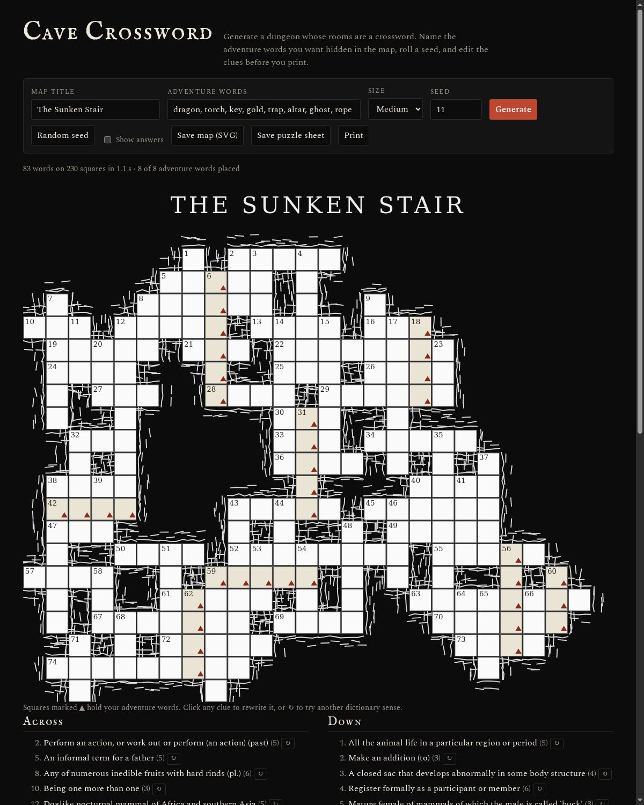

# Cave Crossword

**Generate a dungeon map whose rooms are a crossword.** A cave is carved procedurally, then filled with real interlocking words, and your adventure words are hidden inside it. You get a printable map, a clue sheet you can edit, and an answer key.



**[Download `dist/cave-crossword.html`](dist/cave-crossword.html)** and open it in any browser. It's a single 4 MB file that works offline and sends nothing anywhere.

## What it does
- **Carves a cave** with a cellular automaton (the classic cave-smoothing rule), then reshapes it so every run of squares is a legal crossword entry.
- **Fills it with real words.** A constraint solver places words; when a region can't be filled, it adds rock and tries again.
- **Hides your adventure words** (DRAGON, KEY, ALTAR…) in the map and marks their squares ▲. The DM reveals what a room holds when its word is solved.
- **Writes clues offline** from Princeton WordNet. Every clue is editable, and ↻ swaps in another dictionary sense.
- **Same seed, same cave.** Maps are fully reproducible.

## Use it
Browser: open `dist/cave-crossword.html`, enter a title and adventure words, then click Generate. Save the map as SVG, save the puzzle sheet, or print.

Command line (Node ≥ 20, no dependencies):
```sh
npm run generate -- --seed 7 --w 40 --h 26 --theme "dragon,torch,key,gold,trap" --title "The Sunken Stair" --out out/stair
# writes out/stair.html (puzzle + clues), out/stair.svg (map), out/stair-key.svg (answers), out/stair.json
npm run build        # rebuild dist/cave-crossword.html
npm run data         # re-download word lists and WordNet, rebuild lexicon and clues
```

## How it works
| Piece | File |
|---|---|
| Cave layout: cellular automaton, crossword legalisation, largest-component cleanup | `src/cavexword/layout.mjs` |
| Filler: bitset word index, most-constrained-slot search with forward checking, incremental domain counts, adds rock on failure | `src/cavexword/fill.mjs` |
| Ink-style SVG rendering: procedural rock hatching, clue numbering | `src/cavexword/render.mjs` |
| Offline clues from WordNet | `tools/build_clues.mjs`, `src/clues.mjs` |
| Standalone page | `web/`, `tools/build_standalone.mjs` |

Filling an open, irregular shape is the hard part: crossword fillability collapses past a tipping point as grids get more open, a phase transition studied by Anbulagan & Botea (CP 2008, SoCS 2009). The generator stays on the fillable side by adding rock where the search fails. See [`research/gap1_deep_lit.md`](research/gap1_deep_lit.md).

## Prior art
- **Crossword Dungeon:** [2012 iOS game](https://www.roguebasin.com/index.php/Crossword_Dungeon) and [2026 itch.io game](https://enegames.itch.io/crossword-dungeon). Both treat letters as rooms in standard newspaper-style grids.
- **Hand-made crossword dungeon maps** by human artists inspired the shape-first approach.
- As far as we found, this is the first open tool that generates the cave shape and fills it.

## Background research
This project began as **WordLife**, an experiment in whether spelling rules can drive an artificial-life ecosystem. Short answer: they can't. Real English behaves like matched fake lexicons in every model tested. The models, experiments and write-up are kept in [`research/RESEARCH.md`](research/RESEARCH.md), `src/models/`, `experiments/` and `sandbox/`.

## Data licences
- Word lists: SCOWL (permissive) and ENABLE (public domain).
- Clues: Princeton WordNet 3.0.

Notices are in [`data/LICENSES.md`](data/LICENSES.md).
